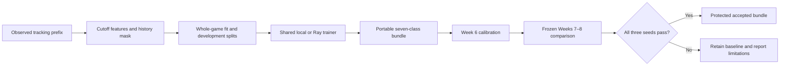
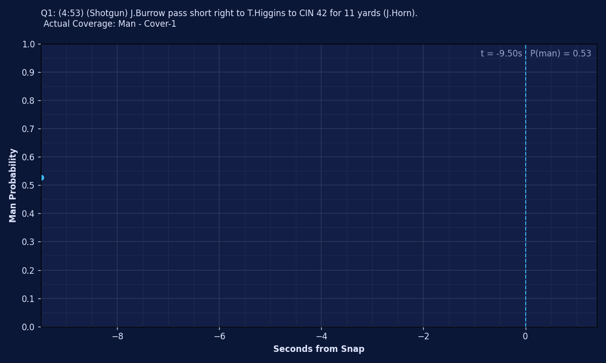
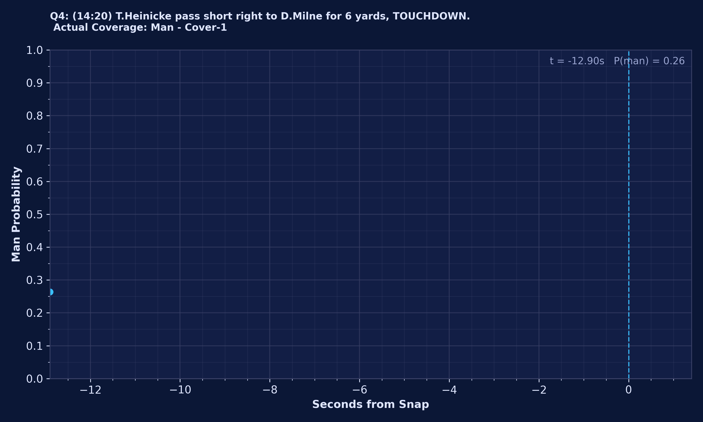
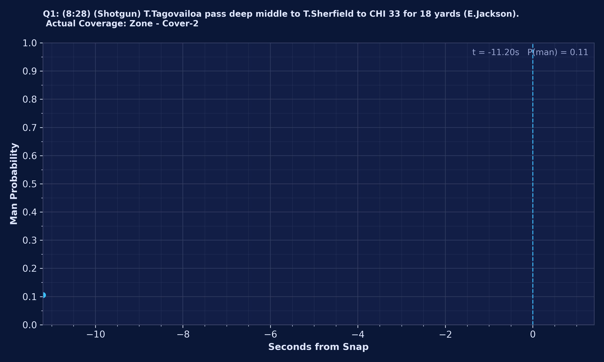
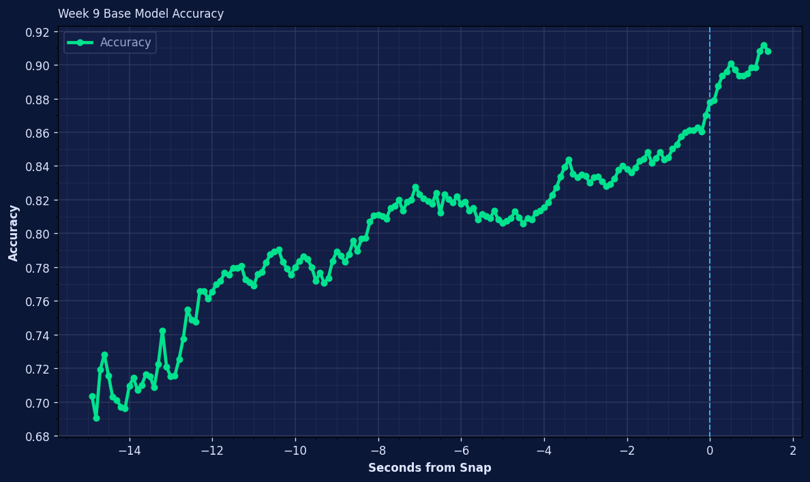

# NFL pre-snap coverage prediction

Predict seven coverage labels from player tracking observed before the snap: Cover 0, Cover 1, Cover 2, Cover 3, Quarters, 2-Man, and Cover 6. Man probability is the sum of Cover 0, Cover 1, and 2-Man. The maintained pipeline supports spatial and masked temporal models, geometric baselines, calibrated probabilities, portable bundles, and bounded local/Ray experiments.

Evaluation separates fitting, development, calibration, and final comparison by whole games. The primary endpoint is 0.1 seconds before the snap; a separate one-second endpoint checks earlier prediction. This is an existing labeled pass-play cohort, with exclusions recorded in the dataset manifest. Weeks 7–8 and historical Week 9 were exposed during older development, so their new comparisons cannot establish fresh-data generalization.

[Approved protocol](docs/superpowers/specs/2026-10-10-coverage-modernization.md) · [Implementation plan](docs/superpowers/plans/2026-10-10-coverage-modernization.md) · [Runtime decisions](docs/reports/2026-10-11-runtime-decisions.md) · [Frozen results and gates](docs/reports/2026-10-11-coverage-comparison/README.md) · [PR delivery stack](docs/reports/2026-10-11-delivery.md)

The [October 16 improvement campaign](docs/reports/2026-10-16-coverage-improvement/README.md) tested public-data eligibility, training duration, play sampling, learning curves, context, motion and mild class weighting. None passed the advancement guards; no model was promoted. Its current-runtime benchmarks and development results are separate from the frozen v1 results below.

## Maintained workflow

Use Python 3.12 and the locked worktree-local environment. If global uv is older, bootstrap with:

```bash
uvx --from uv==0.12.17 uv sync --locked --extra tuning
.venv/bin/nfl --help
.venv/bin/pytest -q -m 'not integration'
.venv/bin/ruff check src tests scripts
.venv/bin/pyright
```

Every command requires explicit input and output paths; existing outputs are protected. Raw Parquet files remain read-only.

```bash
.venv/bin/nfl audit --data-root /path/to/data/parquet --run-dir artifacts/runs/audit
.venv/bin/nfl prepare --data-root /path/to/data/parquet --run-dir artifacts/runs/dataset --config configs/coverage.json
.venv/bin/nfl train --data-root artifacts/runs/dataset --run-dir artifacts/runs/training --config configs/training.json
```

`predict` accepts a JSON config naming `bundle`, `split`, `batch_size`, and `device`. For unlabeled live observations, `prepare` accepts `unlabeled: true`, `tracking_file`, and `requests_file` (Parquet paths relative to `--data-root`); it requires no coverage labels or outcomes. `calibrate` uses the designated Week 6 role only. `evaluate` verifies complete keyed cohorts and emits confusion/calibration plots. `experiment` enforces persisted budgets; recovery requires `resume: true` with the same frozen configuration. See `configs/experiment.json` for a bounded search and `configs/final-comparison.json` for the frozen three-seed protocol.

A real-data integration check is isolated and performs no final-role inference or scoring:

```bash
.venv/bin/python scripts/integration_check.py --data-root /path/to/data/parquet --run-dir artifacts/runs/integration --device cpu
.venv/bin/pytest -q tests/test_tune_smoke.py -m integration
```

GPU training uses one job at a time. FP32 is the measured default; AMP and compilation remain explicit experiments. Bundle metadata records vocabulary, preprocessing schema, weight hashes, source provenance, runtime, and calibration.

## Pipeline



The October 2026 neural model improved mean seven-class macro precision from **46.84% to 50.51%**, macro recall from **40.76% to 45.74%**, and macro-F1 from **41.88% to 46.61%**. It failed binary/recall/earlier-endpoint promotion gates; no accepted-model pointer was written. The preselected seed 42 reached 55.07% macro precision, 46.63% macro recall and 58.40% accuracy. These are equal-class metrics on historically exposed weeks, not a comparison to the old binary headline.

Batching reduced a matched prepared-week GPU prediction workload from **1.656 s to 0.128 s (12.9×)** and CPU prediction from **1.044 s to 0.248 s (4.2×)**. A shared-host GPU repeat varied substantially. Compiled training kernels improved 1.16× with a 7.23 s cold step; the full-training 1.5× target was not established, so compilation stays off. See the frozen report for workload boundaries and all repeats.

## Historical binary demonstrations

The examples below belong to the original binary models and their older evaluation protocol. Their approximately 88% Week 9 accuracy is not directly comparable to the seven-class, play-level evaluation.

# Demo


### 2022 Week 9: Panthers at Bengals
Let's look at a play that goes swimmingly based on the coverage tell. On 2nd and 8 against Carolina, Joe Burrow gets his coverage answer right away. He motions Tyler Boyd (#83) across the formation and C. J. Henderson (#24) travels with him. That’s a clean man coverage indicator. Carolina is also crowding the line, showing pressure, so Burrow knows he’s in a quick-throw situation.

The route design plays perfectly off that read:
- Boyd’s motion and flat route pull Henderson toward the boundary
- Tight end Mitchell Wilcox (#84) pushes vertically and forces free safety Myles Hartsfield (#38) to gain depth in the middle of the field
- Reciever Tee Higgins (#85) is isolated one-on-one with cornerback Jaycee Horn (#8). Higgins is running a curl, and Horn is aligned eight yards off to protect himself against the vertical stem, leaving plenty of space for the break.

With man coverage confirmed and pressure likely, Burrow hits the top of his drop and fires in rhythm. Higgins snaps off his curl into the open window Horn has surrendered, and Burrow delivers an easy first down created by the motion tell, the pressure look, and the spacing built into the concept.


Fortunately the model spots the same man coverage tell! Once Boyd goes in motion about 3 seconds before the snap with Henderson mirroring his movements, the model's predicted man coverage probabilty shoots up from under 20% to 90% at the snap.


### 2022 Week 9: Vikings at Commanders
Now let's look at play that has a hiccup but still ends up working from the coverage tell. In a red zone snap in the fourth quarter, the Commanders are looking for a score on 2nd and 5. Reciever Curtis Samuel (#10) goes in motion to the left, and Vikings corner Chandon Sullivan (#39) follows him across the formation. That’s the indicator the Commanders want, straight man coverage.

Washington sells the run hard off the snap, and Vikings linebacker Erick Kendricks (#54) gets pulled downhill by the action. On the perimeter, Patrick Peterson (#7) is locked up one-on-one with Dax Milne (#15), the intended target.

However, the play isn’t completely clean. Vikings safety Harrison Smith (#22) doesn’t bite on the fake. Instead he hangs back, reads Commander's QB Taylor Heinicke’s eyes, and becomes a floating defender in space, squeezing the throwing lane as Milne makes his break. Even so, the design and the man tell still carry the play. Milne snaps his route toward the pylon with just enough separation, and Heinicke trusts the matchup. After a brief hitch as he confirms the leverage, he drives the ball to the front corner. Milne secures it and turns upfield through contact for the touchdown.


The model picks up the same man coverage tell as Vikings defender Chandon Sullivan follows Curtis Samuel's motion one second before the snap. A frame before the motion the model is prediction 40% man coverage probability but after the motion predicts 93% man coverage probabilty.



### 2022 Week 9: Dolphins at Bears
Finally let's look at a play where things aren't quite what we expect. On 3rd and 6, Miami sends tight end Durham Smythe (#81) in motion from a wide alignment into the backfield. Chicago safety DeAndre Houston-Carson (#36) tracks the motion inside, which normally reads as a man coverage indicator. Once Smythe sets, Houston-Carson communicates with linebacker Nicholas Morrow (#53), suggesting a possible switch in responsibilities and adding to the illusion that Chicago is matching the motion.

But post snap the picture changes. The Bears settle into Cover 2, with two deep safeties holding their shells and the underneath defenders sinking into their zone drops. The motion makes the coverage looks like man, but the structure is pure zone.

The ball is snapped and as Chicago’s curl-flat defender widens and the deep half safety stays high, a window opens on the left hash. With time in the pocket Dolphin's quaterback Tua Tagovailoa reads the post snap picture cleanly and fires a hole shot between the underneath defender and the half-field safety, dropping an 18-yard completion into the void Cover 2 naturally concedes.


Unfortunately, the model is not able to pick up on this disguise. The tight, mirrored defender-reciever alignement and defender tracking the motion acts as a false positive wtih the model mistankely predicting 85% man coverage probabilty moments before the snap. Of course, this turns into Zone so this would be a miss! Fortunately, the model does realize it's mistake after the snap and nose dives in man coverage probability, seeing the defenders drop in space as clear zone tells.



### Week 9 Overall
If we look across all plays in Week 9, our model on average is ~88% accurate in identifying man or zone pass coverage moments before the snap. The plot below illustrates the increasing confidence based on pre-snap movements and locations of players vs time




## Data

The raw data that was provided by NFL NextGenStats has been removed from the original Kaggle source. The orginal csv data has been transformed to parquet data and stored with git large file storage (LFS).

To retrieve the data, first install git LFS

```bash
# Install git lfs
sudo apt install git-lfs

# Navigate to where you cloned this repo
cd some-path/nfl

# Seperately run a pull with lfs
git lfs install
git lfs pull
```

This will fully populate `data/parquet/*` with:

`2021/`:
- `games.parquet`
- `pffScoutingData.parquet`
- `players.parquet`
- `plays.parquet`
- `tracking_week_1.parquet`
- `tracking_week_2.parquet`
- `tracking_week_3.parquet`
- `tracking_week_4.parquet`
- `tracking_week_5.parquet`
- `tracking_week_6.parquet`
- `tracking_week_7.parquet`
- `tracking_week_8.parquet`

`2022/`:
- `games.parquet`
- `player_play.parquet`
- `players.parquet`
- `plays.parquet`
- `tracking_week_1.parquet`
- `tracking_week_2.parquet`
- `tracking_week_3.parquet`
- `tracking_week_4.parquet`
- `tracking_week_5.parquet`
- `tracking_week_6.parquet`
- `tracking_week_7.parquet`
- `tracking_week_8.parquet`
- `tracking_week_9.parquet`

## Development and optional tools

Use the maintained `nfl` commands above. The former direct-script training, 1,000-trial HPO, inference and profiler instructions have been retired; their binary demonstrations and figures above are historical artifacts. The current search is bounded by `configs/experiment.json`, and benchmark receipts separate warm execution from compilation startup.

```bash
.venv/bin/ruff check src tests scripts
.venv/bin/ruff format --check src tests scripts
.venv/bin/pyright
.venv/bin/pytest -q -m 'not integration'
.venv/bin/pre-commit install
```

Optional packages: `--extra tuning` for Ray, `--extra tracking` for MLflow, `--extra notebooks` for notebooks, and `--extra legacy` for old model dependencies. Install with the pinned uv bootstrap shown above. For local MLflow viewing after installing tracking dependencies:

```bash
.venv/bin/mlflow ui --backend-store-uri sqlite:///mlflow.db --host 127.0.0.1 --port 5000
```

## Remaining research

Seven-class prediction, confusion/calibration reports, batching, typed checks and CPU CI are implemented. The current neural candidate is not promoted: binary discrimination, Cover-1 recall and one-second predictions remain weaknesses; 2-Man recall is particularly low. A future iteration should use development data to address these weaknesses and seek genuinely unexposed games before making a generalization claim. Temporal/context experiments are implemented but did not justify selection. Post-snap identification, blitzer prediction, distributed training and player-specific causal explanations remain outside this release.
