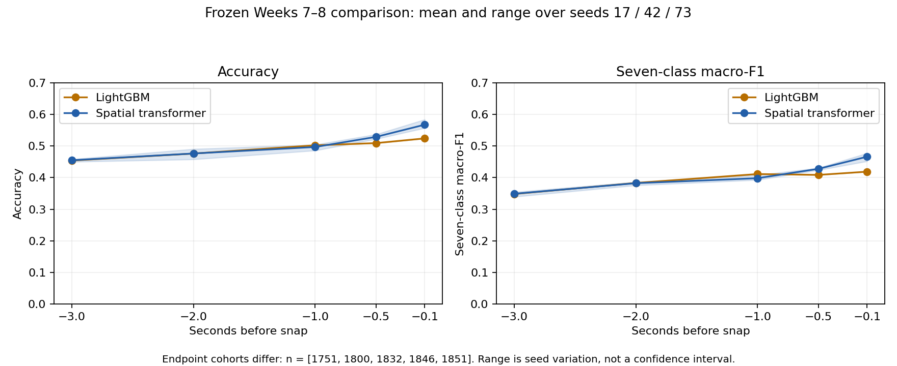
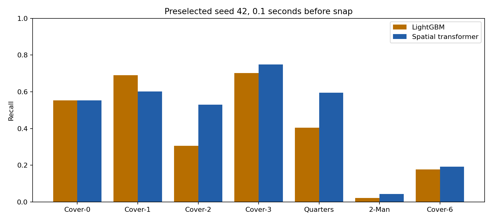
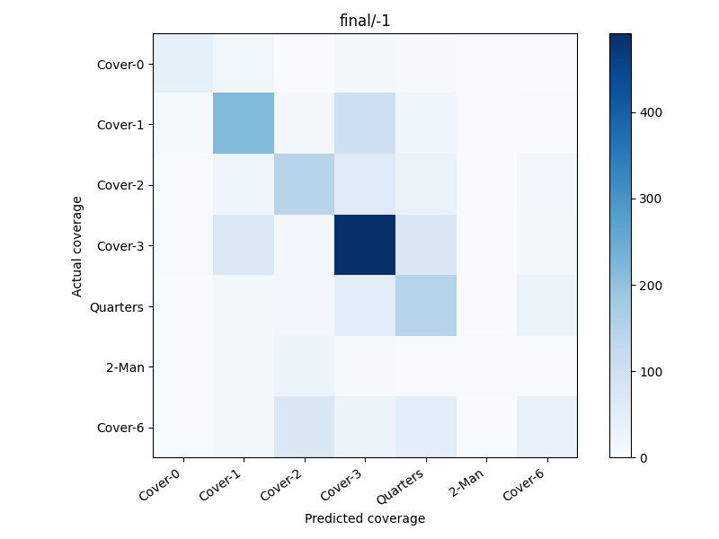
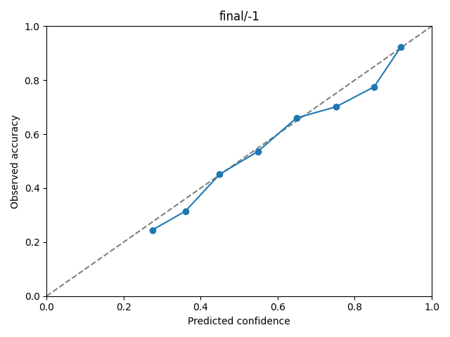

# Frozen coverage modernization result

Seven-class prediction improved at 0.1 seconds before the snap, but the neural model **did not pass promotion**. Its mean macro-F1 was 0.4661 versus 0.4188 for the matched LightGBM baseline. All three game-bootstrap intervals were positive, and calibrated log loss improved. Binary performance, class recall, and the one-second endpoint prevented acceptance. The baseline remains usable; no accepted-model pointer was written and no final-driven tuning followed.

These are 1,851 known-label pass plays from 29 games in 2022 Weeks 7–8. Those weeks were exposed during older development. This is a frozen held-out comparison under the new protocol, **not evidence from newly unseen games**. Historical binary accuracy and post-snap behavior are not comparable.

## Locked primary comparison

| Seed | Neural macro-F1 | LightGBM macro-F1 | Neural accuracy | Neural NLL | Baseline NLL | Paired game-bootstrap 95% interval, F1 difference |
|---|---:|---:|---:|---:|---:|---:|
| 17 | 0.4692 | 0.4188 | 55.70% | 1.1432 | 1.2067 | +0.0171 to +0.0837 |
| 42 | 0.4773 | 0.4188 | 58.40% | 1.1058 | 1.2067 | +0.0277 to +0.0929 |
| 73 | 0.4519 | 0.4188 | 56.13% | 1.1277 | 1.2067 | +0.0115 to +0.0564 |

LightGBM accuracy was 52.40%. Its three seeds produce identical outputs with these deterministic settings; they are not three independent data samples. Bootstrap resampling uses whole games, 2,000 replicates, and seed 42. Deployment seed 42 was chosen before evaluation, not because it scored best. No three-model ensemble was selected.

| Promotion gate | Seed 17 | Seed 42 | Seed 73 |
|---|---|---|---|
| Provenance, matching cohort and class support | Pass | Pass | Pass |
| Positive game-bootstrap interval | Pass | Pass | Pass |
| Calibrated NLL no worse | Pass | Pass | Pass |
| Derived binary macro-F1 loss ≤1 percentage point | **Fail** | **Fail** | **Fail** |
| Supported-class recall loss ≤5 points | Pass | **Fail** | Pass |
| One-second macro-F1 loss ≤1 point | Pass | **Fail** | **Fail** |

Derived binary macro-F1 was 0.7618 / 0.7752 / 0.7737 versus LightGBM's 0.8013. Corrected binary transformer references scored 0.7672 / 0.7834 / 0.7728; the gate compares against the stronger reference, including the baseline. At one second, neural scores were 0.4080 / 0.3936 / 0.3927 versus 0.4113. All seeds must pass every gate. The implementation conservatively requires at least 20 examples in every class; this is stricter than checking recall only for adequately supported classes, and has no effect here because all seven meet that count.



The shaded range is seed variation, not a confidence interval. Horizon cohorts differ because missing history is excluded; each neural/baseline comparison uses identical keyed plays. The chart does not establish a causal effect of moving closer to the snap.

## Coverage and calibration

| Class | Primary support | Seed 42 neural recall | Baseline recall |
|---|---:|---:|---:|
| Cover 0 | 76 | 55.26% | 55.26% |
| Cover 1 | 362 | 60.22% | 69.06% |
| Cover 2 | 272 | 52.94% | 30.51% |
| Cover 3 | 656 | 74.85% | 70.12% |
| Quarters | 247 | 59.51% | 40.49% |
| 2-Man | 46 | 4.35% | 2.17% |
| Cover 6 | 192 | 19.27% | 17.71% |

Cover 1 recall fell 8.84 points for seed 42. Rare-class 2-Man recall remains poor despite the aggregate improvement. Exact confusion matrices, class F1, Brier score, ECE, calibration bins, and every horizon's counts are in [comparison.json](comparison.json).





Scalar temperature and confidence thresholds were fitted on 949 Week 6 primary-endpoint plays only. Seed 42 neural temperature was 0.7901; calibration-role NLL improved from 1.0351 to 1.0150. Its threshold 0.57 answered 55.05% of final plays at 71.74% answered accuracy. That differs from the calibration target of 75%; it is not a guaranteed accuracy service level. Abstentions remain in overall metrics. There is no novel-class detection claim. Seed 42 final Brier/ECE were 0.5538/0.0302 versus baseline 0.6018/0.0517.

Across the full source cohort, exclusions include 7,237 non-pass plays, 944 unknown/nonstandard labels, and 30 missing/ambiguous snap plays. The 23,551 invalid-cutoff exclusions count **play/horizon opportunities**, not distinct plays. Original primary-endpoint counts: fit 11,793, development 1,049, calibration 949, final 1,851, historical 815. Training includes fit-only augmentation and all available endpoints. Snapshot and temporal ablations were matched to 2022 where required because most 2021 plays have only half a second of history.

Historical Week 9 is reported separately: preselected neural seed 42 macro-F1 0.4847, accuracy 61.35%; LightGBM macro-F1 0.4980, accuracy 54.48%, n=815. It did not determine selection or promotion.

## Performance evidence

Measurements use an RTX 4090, Torch 2.9.1, four CPU threads, FP32, and verified prepared Week 5 tensors. Raw tracking preparation is outside the weekly prediction timing. No speedup claim includes data download, preprocessing, calibration, or report generation.

| Matched workload | Reference | Optimized | Interpretation |
|---|---:|---:|---|
| Earlier matched GPU prepared-week prediction, batch 1 →512 | 1.656 s | 0.128 s | 12.9×; same inputs and model |
| Selected-runtime repeat, batch 1 →512 | 5.467 s | 0.166 s | 33.0× median; shared-host variability is substantial |
| CPU prepared-week prediction, batch 1 →512 | 1.044 s | 0.248 s | 4.2× |
| Selected-runtime FP32 training kernel, eager →compiled | 2.705 ms | 2.331 ms | 1.16× steady kernel; 7.23 s cold compiled step |

Selected-runtime batch-one repeats ranged from 2.315 to 10.664 seconds; batch-512 repeats ranged from 0.129 to 0.173 seconds. Another project had an existing GPU allocation, left untouched. These shared-host timings are not a dedicated-GPU guarantee. Full training did not establish the proposed 1.5× target. Compilation remains off because startup is material for short runs. BF16 and temporal additions failed development quality or cost tradeoffs; Torch 2.13 was rejected for a measured workload regression. See [runtime decisions](../2026-10-11-runtime-decisions.md).

The six confirmation subprocesses consumed 139.92 elapsed GPU-accounted seconds. Including the conservative imported allowance, the ledger ended at 20 attempts and 4,200.92 seconds, below 24 trials / 24 GPU-hours. Older benchmark overhead is conservatively reserved rather than claimed exactly measured; [development inventory](../2026-10-11-development-budget.json) records receipt hashes.

## Reproduction and artifacts

Source frozen at `3c3d2ad`. Dataset hash: `07e30dd6dbee417298224f05db66a90be36f54d7c4fb33de29edd37c5f234ab0`. [Selection receipt](selection.json) records source, lockfile, manifest, benchmark, configuration, seeds and deployment policy. Local versioned artifacts are under `artifacts/runs/final-comparison-v1/`: six checkpoints/bundles, three calibrated sets, keyed predictions, metrics, plots, 50 low-confidence examples, ledger and terminal receipt. They are intentionally outside Git; this report and compact evidence are tracked.

```bash
uvx --from uv==0.12.17 uv sync --locked --extra tuning
.venv/bin/nfl prepare --data-root /path/to/data/parquet --run-dir artifacts/runs/dataset-v1 --config configs/coverage.json
# Generate the matching benchmark before freezing (bundle is a development-trained model).
.venv/bin/nfl benchmark --data-root artifacts/runs/dataset-v1 --run-dir artifacts/runs/gpu-benchmark-final-config-v2 --config /path/to/benchmark-config.json
.venv/bin/nfl experiment --data-root artifacts/runs/dataset-v1 --run-dir artifacts/runs/final-comparison-v1 --config configs/final-comparison.json
.venv/bin/python scripts/summarize_comparison.py --run-dir artifacts/runs/final-comparison-v1 --output-dir docs/reports/2026-10-11-coverage-comparison
```

For an interrupted existing comparison, copy the same JSON configuration and add only `"resume": true`. Frozen source, lock, data, benchmark and configuration must still match. Completed prediction/report stages are hashed and reused. Fresh experiments need their own output directories, benchmark receipt and accurate prior-budget counters; do not relabel this historical comparison as a new holdout.

Portable seed 42 baseline and neural exports are in `artifacts/runs/final-comparison-v1/exports/`. The baseline was loaded from the fresh locked environment outside the checkout and predicted a real unlabeled observation prefix with no training data or coverage/outcome fields. It emitted seven valid keyed probabilities; this is portability evidence, not new predictive validation.

Validation: 96 fast tests; one actual Ray Tune checkpoint test; Ruff, formatting and Pyright; isolated bounded real-data preparation, two-epoch training plus resume to three, calibration and prediction without final-role inference or scoring. Synthetic final-flow tests inject training interruption, late-stage interruption and a corrupt terminal, verify no completed scoring is repeated, and prohibit fixture promotion. Independent read-only review resolved all Important findings before freeze. Remote CI status is recorded in the PR delivery index.
