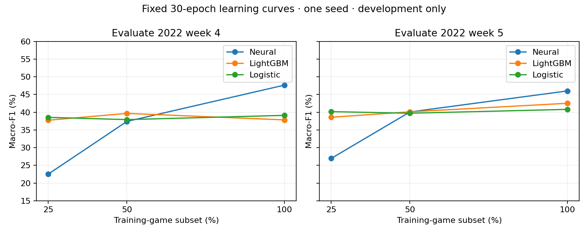

# Coverage improvement campaign — 2026-10-16

**The campaign did not identify a candidate that passes the improvement gates.** More epochs, equal-play sampling, added context, motion summaries and mild class weighting were tested. No accepted-model pointer changed. The original v1 evidence is untouched.

## Results on matched development games

These are equal-weight means over two chronological outer development folds, seed 42. Each fold chooses its checkpoint on an earlier, separate week. There are 1,994 evaluation plays across 32 games (2022 weeks 4 and 5). These games were historically exposed: this is development evidence, not a fresh test or a direct comparison with the v1 weeks 7–8 headline.

| Recipe | Macro precision | Macro recall | Macro-F1 | Binary F1 | F1 at one second before snap |
|---|---:|---:|---:|---:|---:|
| Retained 30-epoch reference | 52.54% | 44.92% | 46.82% | 78.23% | 38.32% |
| Up to 100 epochs, early stopped | 51.38% | 45.17% | 46.84% | 79.05% | 39.65% |
| Longer schedule, equal-play sampling | 52.16% | 47.55% | 48.01% | 79.72% | 39.52% |
| Mild unique-play class weighting | 50.29% | 49.69% | 48.90% | 75.47% | 38.80% |
| Matched LightGBM | 50.18% | 38.93% | 40.17% | 79.03% | 36.07% |
| Matched logistic regression | 45.63% | 39.26% | 39.95% | 79.96% | 35.28% |

The longer schedule raised one inner-validation result from 48.2% to 57.0%, but barely changed outer-fold F1. Equal-play sampling improved the mean by 1.19 points, with a 1.31-point earlier-horizon loss on the first fold; it did not clear the two-point screen or consistent-improvement requirement.

Mild weighting gained 2.08 mean F1 points but lost 2.25 precision points and 2.76 binary F1 points; Cover-1 recall dropped 13.77 points. It fails the non-regression guards and the three-point advancement threshold. Its separately calculated **pooled** F1 gain is 3.10 points, with a paired game-bootstrap 95% interval of **−0.66 to +6.29 points**. Pooling is a different statistic from the predeclared mean of fold metrics; neither analysis establishes an acceptable improvement.

Pooled 2-Man recall rose from 15.0% to 37.5%, but only 40 true examples across 20 games support that observation. Recall intervals are wide (reference 5.4–27.8%, weighted 17.4–55.1%); the campaign's 20-point interval-width requirement is unmet. No reliable rare-class improvement is claimed. [summary.json](summary.json) contains every class's precision, recall, support, predicted count, contributing games, uncertainty and confusion matrix. Its `campaign_support_resolved` field applies the stricter campaign rule; the older `sufficient_support` field merely checks 20 examples.

## What the data-size and information tests show



Neural mean F1 rose from **24.73% → 38.73% → 46.82%** at 25/50/100% of training games. LightGBM rose **38.14% → 39.88% → 40.17%**, with inconsistent individual folds. Subsets are nested whole-game samples with unchanged validation IDs. The neural schedule is fixed at 30 epochs, so larger subsets also receive more optimizer updates: this supports further compatible-data investigation but does not isolate a pure data-volume effect. These are one-seed curves, not uncertainty estimates.

Two CPU information screens used fixed LightGBM parameters and identical cohorts within each comparison:

- **Down and yards to go:** mean primary F1 +1.13 points; one fold improved and the other regressed. Earlier-horizon mean F1 fell 0.80 points. No neural context fit was justified by the two-point screen.
- **Observed player displacement and opponent-separation changes:** mean primary F1 −0.99 points. Both models used the same 2022 examples with at least ten observed history frames; the first and last observed frames preserve player identity, and masked frames are excluded. No larger temporal encoder was justified.

These results reject these particular features/recipes under this protocol, not the general value of football context or motion. [Information-screen receipts](information-screens.json) preserve per-fold and per-horizon results and source hashes.

## Public data

[The source audit](source-audit.md) verified 18,297 candidate seven-class labels for 2018 and newer participation labels, but **zero newly qualified tracking plays**. Existing BDB 2023/2025 releases overlap local 2021/2022 material. Official BDB 2021 and 2027 tracking APIs returned HTTP 401, and no Kaggle credentials were configured. New tracking eligibility remains blocked on authorized access, terms, joins, pre-snap history and player completeness. No paid data or unofficial mirrors were used.

The next data action is to qualify an official tracking sample using an authorized Kaggle account. More labels without compatible tracking do not expand this model's training cohort. Do not automatically relabel hard plays or treat newer FTN categories as equivalent without a taxonomy audit.

## Current performance

Measured on the RTX 4090 with Torch 2.10.0, four CPU threads, unchanged reference architecture and FP32 inference. Five warmups and 30 repeats were used for kernel/step timings; the complete prediction path was repeated three times. Desktop graphics remained active, so these are workstation measurements rather than isolated-device maxima.

| Measurement | CPU | GPU |
|---|---:|---:|
| One example, warm model only | 0.530 ms | 0.799 ms |
| 512 examples, warm model only | 18.111 ms | 0.801 ms |
| 512-example training step, forward/backward/update | 123.371 ms | 5.833 ms |
| 4,679 prepared examples, batch 512, verified load through prediction-file write | 0.328 s | 0.190 s |
| Same complete prediction path, batch 1 | 2.509 s | 4.531 s |

GPU BF16 was slower here: 1.405 ms per 512-example inference batch and 7.207 ms per training step. FP32 remains the research reference. GPU peak allocated memory during the benchmark was **158.7 MiB**; this is PyTorch allocation, not total board memory or campaign-wide peak. The complete prediction path includes prepared-shard loading and verification, model loading, batching and Parquet writing; **it excludes raw tracking-to-shard preparation**. Its OS cache was uncontrolled. Training fits record examples, unique plays, epochs and optimizer updates; disposable benchmark steps are not model-quality experiments.

[CPU receipt](benchmark-cpu.json) and [GPU receipt](benchmark-cuda.json) contain raw timing repetitions, p95 latency, parity checks and environment details. These are current measurements, not claims of speedup caused by this PR over v1. Training completed 14 fits in **345.6 charged GPU seconds**. Including one benchmark allocation, total charged GPU time was **361.7 seconds (6.03 minutes)** across 15 allocations, well below the 36-allocation/four-hour ceiling. The initial six-fit pilot used 199.1 seconds of its 1,800-second cap.

## Decisions and remaining gates

1. Retain the existing research reference; promote nothing.
2. Stop context, motion and objective screens after their failed guards. Leave unused GPU slots unused.
3. Skip three-seed confirmation and final refits because no screen qualifies. No seed-robust gain is established.
4. No fresh cohort qualified. Fresh-generalization acceptance remains unmet.
5. No new calibrated or abstaining model is delivered. Independent calibration and 25/50/75% answer-rate evaluation remain conditional on a qualifying candidate and evaluation protocol; temperature scaling cannot repair these discrimination regressions.

## Reproduction and changes

Base revision: `528d581` (current security/runtime upgrades preserved). [Approved plan](../../plans/2026-10-16-coverage-improvement.md). [Provenance](provenance.json).

- `development.build_fold` creates hashed local views of immutable prepared shards. Fold A: fit 2021 + 2022 W1–2, checkpoint-select W3, evaluate W4. Fold B: fit 2021 + 2022 W1–3, select W4, evaluate W5. Weeks 6–9 never enter these folds; evaluation has no mirrors.
- `sampling: "play"` samples inverse endpoint-count weights, including mirrors, with replacement and the same update count. The sampler generator is checkpointed and exact resume is tested.
- `class_weighting: "sqrt_play"` uses square-root inverse frequency from unique training plays, capped at 3. The existing boolean weighting behavior is retained.
- Explicit experiment ceilings may now reach 36 attempts; the default remains 24. Batch receipts carry prior attempts/time forward, and a locked receipt chain prevents stale-budget reuse. Interrupted batches fail closed for inspection rather than silently resetting the budget.

Run from this worktree with `uv sync --locked --extra tuning` and `PYTHONPATH=src`. All output directories must be new. The local source manifest used here is `../coverage-modernization/artifacts/runs/dataset-v1/manifest.json`; replace it with your verified prepared dataset path on another host.

```bash
PYTHONPATH=src .venv/bin/python scripts/run_coverage_pilot.py SOURCE_MANIFEST artifacts/runs/new-campaign
PYTHONPATH=src .venv/bin/python scripts/score_development.py artifacts/runs/new-campaign --baselines
PYTHONPATH=src .venv/bin/python scripts/score_development.py artifacts/runs/new-campaign
# After reviewing the stage gate, freeze jobs as a JSON list of manifest/trials objects.
PYTHONPATH=src .venv/bin/python scripts/run_development_batch.py JOBS_JSON PRIOR_TERMINAL_JSON NEW_STAGE_DIRECTORY
PYTHONPATH=src .venv/bin/python scripts/score_development.py NEW_STAGE_DIRECTORY --batch --baselines
PYTHONPATH=src .venv/bin/python scripts/score_development.py NEW_STAGE_DIRECTORY --batch
PYTHONPATH=src .venv/bin/python scripts/screen_information.py CAMPAIGN_DIRECTORY RAW_PARQUET_DIRECTORY NEW_OUTPUT_DIRECTORY
```

Use one common campaign parent directory for all batch outputs so the receipt chain is shared. Local raw predictions, checkpoints, per-epoch histories and manifests remain under `artifacts/runs/coverage-v2/`; small immutable result receipts are included here. Exported plans preserve the exact jobs; absolute shard locations in local views must be rebuilt on another host.
