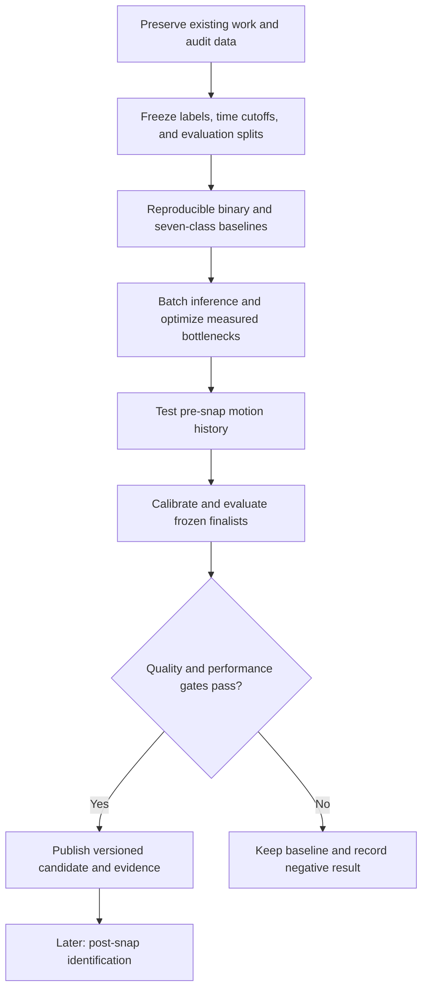

# NFL coverage prediction: proposed direction

Status: **Implementation and frozen evaluation completed October 11, 2026; neural promotion rejected.** This document preserves the approved protocol and original planning audit, not current runtime state. See [results](../../reports/2026-10-11-coverage-comparison/README.md) and [delivery](../../reports/2026-10-11-delivery.md) for outcomes and review/merge status.

Date: October 10, 2026. Scope confirmed in chat: **pre-snap prediction first; post-snap identification later.**

## Recommendation

Keep the existing PyTorch, Ray Tune, MLflow, uv, and Ruff foundation. Build a trustworthy seven-class benchmark, remove the obvious data-processing and inference bottlenecks, and then test whether motion history improves predictions. Modernize dependencies in small, verified increments. Adding frameworks is not a success metric.

The useful output is a calibrated distribution over Cover 0, Cover 1, Cover 2, Cover 3, Quarters, 2-Man, and Cover 6, updated as pre-snap tracking arrives. Predict the coverage eventually played; do not confuse that target with the defensive shell currently shown. A two-high shell does not uniquely identify the eventual coverage. Return uncertainty when the evidence is ambiguous.

## What was verified in this checkout

The checked-out branch is `feature/tune-model`, commit `fc898aa`. Remote branch inspection returned the same feature-branch tip and `main` at `8e4dbc0`; this planning audit did not fetch, switch branches, or alter history. The feature branch contains work beyond local main. There are existing uncommitted edits to `notebooks/eda.ipynb` and `src/train_transformer.py`; the latter is a substantial Ray Train migration. Preserve both.

| Finding | Evidence and implication |
|---|---|
| Seven-class labels already exist | Both seasons' local `plays.parquet` contain `pff_passCoverage`; `src/clean_data.py::label_offense_defense_coverage` already canonicalizes seven classes. No manual labeling project is needed to start. |
| Transformer is spatial, not temporal | `ManZoneTransformer.forward` accepts `[batch, players, features]`. Repeated frame predictions do not give the network motion history. |
| Pre-snap objective is not isolated in training | `clean_df` retains offsets -150 through +50 frames. `_process_df` also augments the validation week. Post-snap training examples are not automatically leakage into a separate pre-snap inference frame, but training, selection, and reporting need an explicit pre-snap protocol. |
| Headline dataset is reused | 2022 Week 9 supplies training validation/HPO metrics and the README's reported results. Treat the approximately 88% binary result as historical, not an untouched test score. |
| Mirroring has a concrete defect | `data_augmentation` reflects lateral position and direction after velocity components are computed, but does not reflect `v_y`. |
| Inference has avoidable overhead | `generate_predictions.py` filters the weekly table, converts Polars to pandas, creates a tensor, and launches the model separately for every frame. The `batch` list batches CSV writes, not neural inference. |
| Infrastructure already includes modern components | Installed and locked: Torch 2.9.1, Ray 2.51.1, MLflow 3.6.0, Polars 1.35.2, Ruff 0.14.7. Compilation, FP16 autocast, TF32, fused AdamW, and profiling already appear in the training code. These are the local versions, not a claim about latest releases. |
| Automated verification needs work | No tracked pytest suite was found; pytest and Pyright are absent from the current environment. CI regenerates features and runs HPO/training/inference. `myproject-cli` points at a nonexistent placeholder module. |
| Current migration is unfinished | Ruff reports six findings in `train_transformer.py`. Its Tune factory returns a trainer without calling `fit`; its dictionary checkpoint methods are absent from the installed Ray checkpoint implementation. Distributed metric aggregation and best-checkpoint selection need explicit tests. Syntax parsing passes, but that does not establish runtime correctness. |
| GPU performance cannot be established here yet | `nvidia-smi` cannot communicate with the driver in this session. No training or GPU benchmark was launched. Diagnose environment access before planning GPU execution; do not infer that the machine has no GPU. |

### Available labels

Counts below use the existing pass-result cohort (`C`, `I`, `IN`, `S`), before tracking-quality exclusions. Coverage variants are collapsed using the existing mapping.

| Class | 2021 | 2022 | Total |
|---|---:|---:|---:|
| Cover 0 | 262 | 344 | 606 |
| Cover 1 | 1,917 | 1,972 | 3,889 |
| Cover 2 | 1,037 | 1,301 | 2,338 |
| Cover 3 | 2,532 | 2,981 | 5,513 |
| Quarters | 964 | 1,210 | 2,174 |
| 2-Man | 180 | 162 | 342 |
| Cover 6 | 763 | 875 | 1,638 |
| **Supported total** | **7,655** | **8,845** | **16,500** |

An additional 944 cohort plays have missing or nonstandard labels. Report their exclusion explicitly. Do not relabel Bracket, Prevent, Red Zone, Goal Line, Miscellaneous, or missing labels as a standard coverage. A low-confidence prediction is also different from a labeled “Other” coverage. The seven canonical classes have no man/zone contradictions in this metadata audit.

2-Man is scarce enough that overall accuracy could hide poor performance. Count independent plays and games, not the many correlated tracking frames, when assessing evidence strength.

### Motion-history availability

Across all local tracking weeks, joining to the existing pass cohort:

| Tracking availability | 2021 | 2022 |
|---|---:|---:|
| Tracked pass plays | 8,108 | 9,336 |
| At least one pre-snap frame | 8,077 | 9,322 |
| History reaches 0.5 s before snap | 8,048 | 9,290 |
| History reaches 1 s before snap | 42 | 9,243 |
| History reaches 2 s before snap | 31 | 9,104 |
| History reaches 3 s before snap | 29 | 8,905 |

These are span counts, not certification of continuous frames or 22 valid players at every frame. Missing explicit snap events affect 23 plays in 2021 and nine in 2022. The implementation audit must count eligible classes after all quality gates.

Use both seasons for snapshot experiments. Develop the main temporal comparison on 2022, comparing snapshot and temporal models on exactly the same plays. Evaluate optional snapshot pretraining on 2021 as a separate experiment. Never manufacture several seconds of motion by backward filling the short 2021 records.

## Scientific contract

### Inputs, labels, and causal evaluation

- Version the class order as `Cover-0, Cover-1, Cover-2, Cover-3, Quarters, 2-Man, Cover-6`, retaining current numeric IDs. Preserve original labels beside canonical labels.
- Pre-snap models receive only measurements available at or before the prediction cutoff, strictly before the snap. Labels may describe eventual coverage; they are targets, never input features.
- Evaluate at offsets -30, -20, -10, -5, and -1 frames, corresponding to -3, -2, -1, -0.5, and -0.1 seconds at 10 Hz. Primary endpoint: -1. Secondary endpoint: -10. Require the exact cutoff frame; report missing endpoints rather than substituting a later frame.
- Each play contributes once per endpoint. Report eligible counts, common-cohort comparisons, per-class precision/recall/F1, macro-F1, top-2 accuracy, log loss, multiclass Brier score, and calibration. Bootstrap by game, not by frame.
- Preserve `(season, gameId, playId, frameId)` and augmentation parent keys throughout preprocessing. Split by whole games before augmentation; augmentation is training-only.
- Snap-relative offsets are retrospective evaluation metadata, not a predictive input. Online inference accepts an observed prefix ending “now” without knowing the future snap time.
- Keep the initial scientific claim conditional on the existing labeled pass-play cohort. `passResult` is an offline cohort selector, not an inference feature. This is not yet a model validated on every potential live play, including scrambles and runs. Inference must still work without outcome fields or coverage labels.
- Start with finite, complete 22-player frames and explicit exclusion receipts. Temporal windows can be shorter and padded with a mask, but cannot fill missing history from the future. Do not silently discard an entire week because one frame is malformed.

### Proposed evaluation allocation

Freeze before model selection:

| Role | Data |
|---|---|
| Fit | 2021 Weeks 1–8 plus 2022 Weeks 1–4 for snapshot models; 2022 Weeks 1–4 for primary temporal comparison |
| Tune and early stopping | 2022 Week 5 |
| Calibrate temperature and confidence threshold | 2022 Week 6 |
| Final locked comparison | 2022 Weeks 7–8 |
| Historical compatibility report | 2022 Week 9 |

Use forward-chaining development checks within Weeks 1–5 to check stability, without allowing later weeks into earlier training folds. Refit all train-derived statistics within each fold. Do not increase tuning based on final scores. Week 6 is for calibrating the already-selected models, not choosing architectures.

**Limitation:** Weeks 7–8 were included in historical training. They are held out from the new experiment, not genuinely unseen by this project's development history. Evaluate all compared models trained from scratch under this protocol. A strong claim of fresh generalization eventually requires additional independently sourced data. Do not silently call Week 9 or a recycled historical split “untouched.”

If any standard class has fewer than 20 final eligible plays, mark its per-class claim insufficient. Keep the seven-class task and report uncertainty; do not change classes or reshuffle the holdout to obtain a better score.

## Model sequence

1. **Cheap baselines:** majority/class priors, a regularized logistic classifier, and LightGBM on pre-snap geometric summaries. Features include sorted defender depths, lateral spacing, receiver-defender distances, and available down/distance/field context. These quantify how much a neural model actually adds.
2. **Corrected binary baseline and seven-class spatial transformer:** keep the existing architecture initially; make feature schema and output dimension artifact-driven. Derive man probability by summing Cover 0, Cover 1, and 2-Man probabilities. Do not force a hard man/zone decision before predicting the specific coverage.
3. **Temporal candidate:** reuse per-frame spatial encoding, then apply a small unidirectional GRU over the frame embeddings. Start with up to three seconds of observed history ending at the current cutoff. Compare against the spatial baseline on matching 2022 plays and endpoints. This is a compact way to test the value of defender reactions to motion.
4. **Conditional research extension:** if temporal context wins, test factorized player/time attention with consistent player identity alignment and time masks. Consider auxiliary supervision from the existing 2022 defender-assignment fields only as a later ablation. Actual assignments/matchups must never become pre-snap inputs.

Features to test incrementally: coordinates relative to line of scrimmage and ball lateral position available at cutoff; direction/orientation encoded as sine/cosine; velocity; acceleration; player position and offense/defense role; defensive depth/spacing; receiver motion and defender-response summaries. Do not add team/player IDs as predictive shortcuts in the first round. Any computed tendency must use only earlier games.

Try ordinary cross-entropy first, then capped class weighting (maximum 5×; compare with no weighting). Avoid combining aggressive oversampling and weighting without evidence. Test temperature scaling on the calibration split. Report performance versus fraction of plays answered when a confidence threshold is used; do not hide abstentions from denominators.

Recent factorized-attention research is a useful architecture reference, but it studies different targets and often includes post-snap context or team-coverage inputs. Its reported scores are not targets or baselines for this project's pre-snap seven-class task. [Coverage-responsibility paper, 2026](https://arxiv.org/abs/2603.25901).

## Performance priorities

1. Build tensors once per bounded chunk, run actual batched model inference, and write predictions keyed by frame. Eliminate repeated whole-week filtering and dataframe round trips. Use the same preprocessing implementation for training and prediction.
2. Measure end-to-end preprocessing, training epoch time, time to a fixed validation score, batch throughput, batch-one p50/p95 latency, cold load/compile time, RAM, and peak GPU memory. Benchmark both CPU and the actual target GPU. Keep profiling separate from timed runs.
3. Replace per-sample tensor collation with direct indexed tensor batches where it wins; benchmark worker counts rather than assuming more workers help. Accumulate metrics on device and transfer once per epoch where possible.
4. Use BF16 when the verified GPU supports it; retain FP32 fallback and FP16 with gradient scaling. Check finite gradients and convergence. Retain fused optimizers and compilation only when they improve the measured workload, including startup costs.
5. Inspect native attention dispatch before adopting another attention library. With only 22 players per frame, Python/data overhead may dominate. Treat ONNX Runtime, TensorRT, quantization, and distillation as later options tied to a specific deployment requirement.

Proposed targets, not measured promises: **at least 5× weekly inference throughput** and **at least 1.5× steady-state training throughput**, with quality preserved. Accept smaller useful optimizations when measured honestly; do not keep complexity solely to hit a target. [PyTorch performance guidance](https://docs.pytorch.org/tutorials/recipes/recipes/tuning_guide.html) and [AMP guidance](https://docs.pytorch.org/tutorials/recipes/recipes/amp_recipe.html).

## Modernization and unattended operation

- Keep uv with an exact lockfile. Separate runtime, development, and optional tuning/notebook dependencies; correct packaging and provide real console commands. Upgrade compatible stable dependencies in cohorts, checking Torch/CUDA and Ray APIs against the chosen versions. Keep Python 3.12 initially; a Python upgrade is not the first performance experiment. [uv dependency groups](https://docs.astral.sh/uv/concepts/projects/dependencies/).
- Add pytest fixtures, Ruff/format checks, and Pyright on maintained code. Use fast CPU tests on PRs; keep real-data/GPU integration separate, bounded, and unable to overwrite production artifacts.
- Use one shared train/evaluate implementation for local training and Tune trials. Retain Ray Tune/ASHA for bounded search. Finish or simplify the existing Ray Train migration based on smoke tests. Use multiple GPUs first for independent trials; use DDP only after demonstrating a benefit for this small model.
- Persist model weights, config, optimizer/scaler state, RNG and sampler state, class vocabulary, feature schema, data/split hashes, Git revision, environment, and metrics. Save portable unwrapped weights; compilation is a runtime choice. “Best” and “latest resumable” checkpoints are different artifacts.
- Follow supported checkpoint APIs for the selected Ray version; current official examples use directory checkpoints. Multi-worker validation must reduce weighted totals, avoid padded-example double counting, and export a model matching the selected metric. [Ray TorchTrainer reference](https://docs.ray.io/en/latest/train/api/doc/ray.train.torch.TorchTrainer.html).
- Give every run a unique directory and terminal receipt with `complete`, `failed`, `budget_exhausted`, or `blocked`. A crash, empty dataset, missing GPU, or dependency failure must not appear as a successful model experiment.
- Use branches `Sam-v6/<descriptive-name>` and worktrees under `.worktrees/<descriptive-name>`. Preserve root edits; use read-only raw data and isolated generated outputs.

### Proposed autonomous execution budget and gates

Approval should cover the first eight implementation tasks below, with these defaults: one GPU job at a time; 24 total GPU-hours including benchmarks and finalist repeats; at most 24 HPO trials total; at most 100 epochs and 60 minutes per search trial; ASHA pruning; three seeds for finalist comparisons; at most three repair attempts for the same failing gate. Reserve half the compute budget for confirmation and reporting. These are proposed ceilings, not authorization to spend now. No cloud purchases, new external data agreements, driver installation, or unbounded searches are included.

For a model replacement, compare against the strongest corrected baseline on identical examples. Require a positive lower bound on the paired game-bootstrap 95% confidence interval for macro-F1 improvement, no worse calibrated log loss, no more than one percentage point loss in derived binary macro-F1, and no more than five points of recall loss for any class with at least 20 final examples. Apply these gates at the primary endpoint; report the secondary endpoint and reject a drop of more than one macro-F1 point there. Use three seed-matched runs; do not select the best seed after seeing final results. If evidence is inconclusive, retain the baseline and deliver the experiment as a negative or inconclusive result.

For same-model implementation optimizations, require frame-key identity and numerical parity in FP32 (`atol=1e-5`, `rtol=1e-4`). Reduced precision is a separate accuracy experiment: finite probabilities, sum-to-one checks, and no more than 0.5 percentage points macro-F1 loss or 1% relative log-loss increase on development data. Freeze the selected runtime before final evaluation.

An agent may complete engineering without producing a better model. Automatic promotion must require evidence; failures do not justify weakening gates or relabeling data. On exhausted budget or unavailable GPU, finish the independent CPU work and issue an explicit blocked/inconclusive receipt. Do not repeatedly ask for routine choices.

## Deliverables and deferrals

Deliver a reproducible seven-class training/inference path, corrected binary comparator, frozen evaluation reports, benchmark comparisons, versioned artifacts, updated visualizations, and reviewed PRs using the repository template. Approval to implement is not automatically approval to merge; default delivery is reviewable PRs unless merge authority is explicitly included.

Defer post-snap identification, player-level coverage assignment, new-season acquisition, distributed training, model serving infrastructure, custom GPU kernels, and runtime export formats until the core gates establish a need. New data discovery may be researched later; do not assume publicly available play-by-play includes tracking or specific coverage labels. The dataset's official documentation distinguishes play-level coverage labels from defender-level assignments. [NFL Big Data Bowl data dictionary](https://www.kaggle.com/competitions/nfl-big-data-bowl-2025/data).

The detailed execution checklist is in [the implementation plan](../plans/2026-10-10-coverage-modernization.md).
